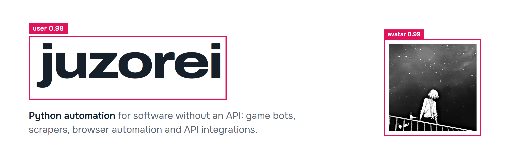
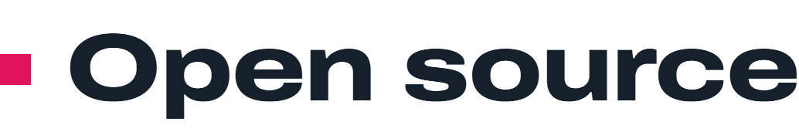
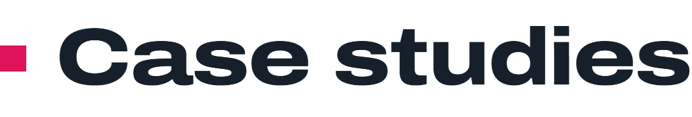
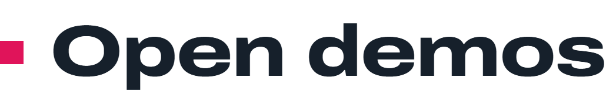

<picture>
  <source media="(prefers-color-scheme: dark)" srcset="banner-dark.png">
  
</picture>

  <a href="https://juzorei.pages.dev">Website</a> ·
  <a href="https://t.me/juzorei">Telegram</a> ·
  <a href="https://discord.com/users/626829853320282145">Discord</a>

I build automation in Python for software that has no API: game clients, websites, desktop apps. Depending on the target, a program reads the screen with OpenCV, reads state straight from process memory, or drives a real browser through Playwright or Selenium.

Tests are written alongside the code (pytest, TDD), and every tool is checked against real data before it's trusted.

<picture>
  <source media="(prefers-color-scheme: dark)" srcset="h-oss-dark.png">
  
</picture>

[**game-re-skills**](https://github.com/juzorei/game-re-skills): agent skills for game reverse engineering (pointer chains, AOB signatures, Unreal and Unity offsets, memory readers, patch-day recovery) and sigtool, a CLI that checks the agent's results. Works with Claude Code, Codex, Cursor and other agents: `npx skills add juzorei/game-re-skills`.

<picture>
  <source media="(prefers-color-scheme: dark)" srcset="h-case-dark.png">
  
</picture>

The source of these projects is private. Each repository is a detailed overview: what the system does, how it is built and where it is still incomplete. Available in English and Russian.

| Project | What it is |
| --- | --- |
| [**Stalbroker**](https://github.com/juzorei/stalbroker-showcase) | Stalcraft auction automation: screen recognition, buying and stack-split selling, crafting, market-data tools and controls for several Windows sessions. |
| [**PoE 2 bot**](https://github.com/juzorei/poe-bot-showcase) | Path of Exile 2 mapping automation: map loop, A* navigation, combat priorities, inventory and stash handling, Atlas, restocking and PoeFleet runner controls. |
| [**Torch**](https://github.com/juzorei/torch-showcase) | Torchlight Infinite campaign automation: memory and screen observation, navmesh routing with A* and funnel smoothing, a live route map and operator panels. |

<picture>
  <source media="(prefers-color-scheme: dark)" srcset="h-demos-dark.png">
  
</picture>

Small runnable projects with source code, offline tests and setup instructions.

| Demo | What it shows |
| --- | --- |
| [webhook-inbox-demo](https://github.com/juzorei/webhook-inbox-demo) | HMAC signature checks, SQLite storage and duplicate-safe retries. |
| [service-log-report-demo](https://github.com/juzorei/service-log-report-demo) | JSONL log validation, latency percentiles, HTTP errors and hourly totals. |
| [api-report-demo](https://github.com/juzorei/api-report-demo) | Paginated GitHub API calls with schema validation and a page budget. |
| [html-catalog-demo](https://github.com/juzorei/html-catalog-demo) | Link extraction from saved HTML with same-origin URL checks. |
| [csv-cleanup-demo](https://github.com/juzorei/csv-cleanup-demo) | Cell normalisation, duplicate removal and a change report. |
| [sqlite-crud-demo](https://github.com/juzorei/sqlite-crud-demo) | Validated records and parameterized create, read, update, delete. |

<picture>
  <source media="(prefers-color-scheme: dark)" srcset="h-friends-dark.png">
  
</picture>

[**di4ela**](https://di4ela.space) — a friend's site, worth a visit.

<picture>
  <source media="(prefers-color-scheme: dark)" srcset="h-tools-dark.png">
  
</picture>

  
  
  
  
  
  
  

